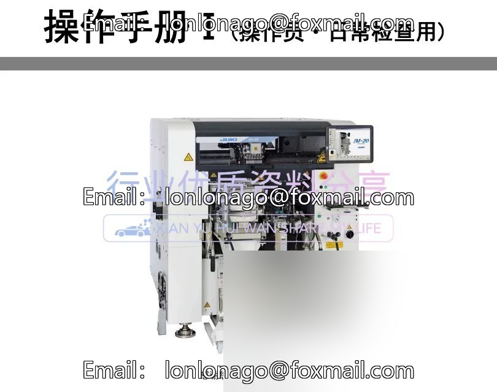
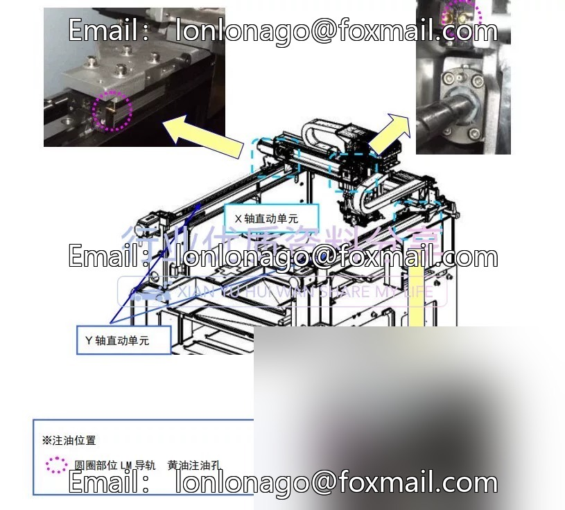
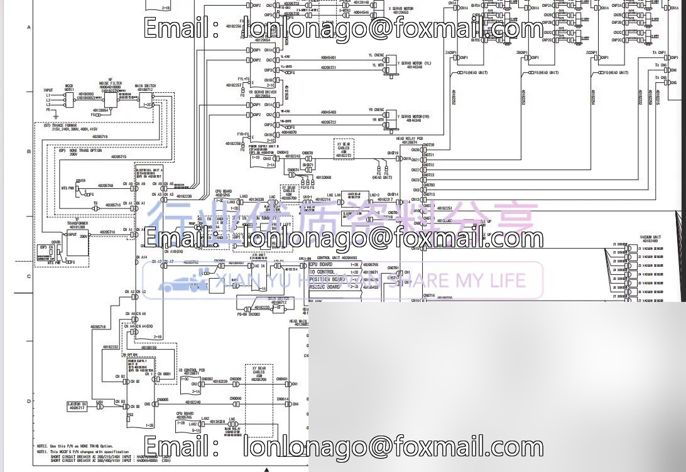
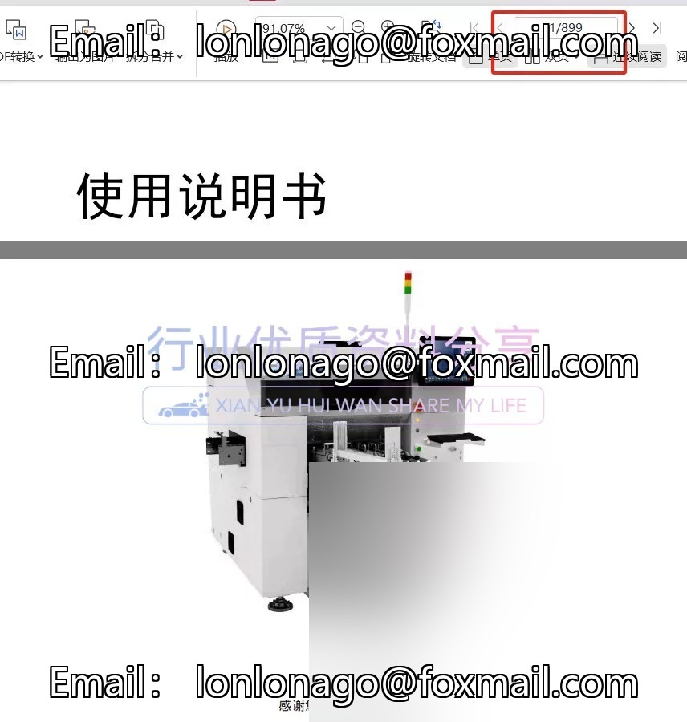
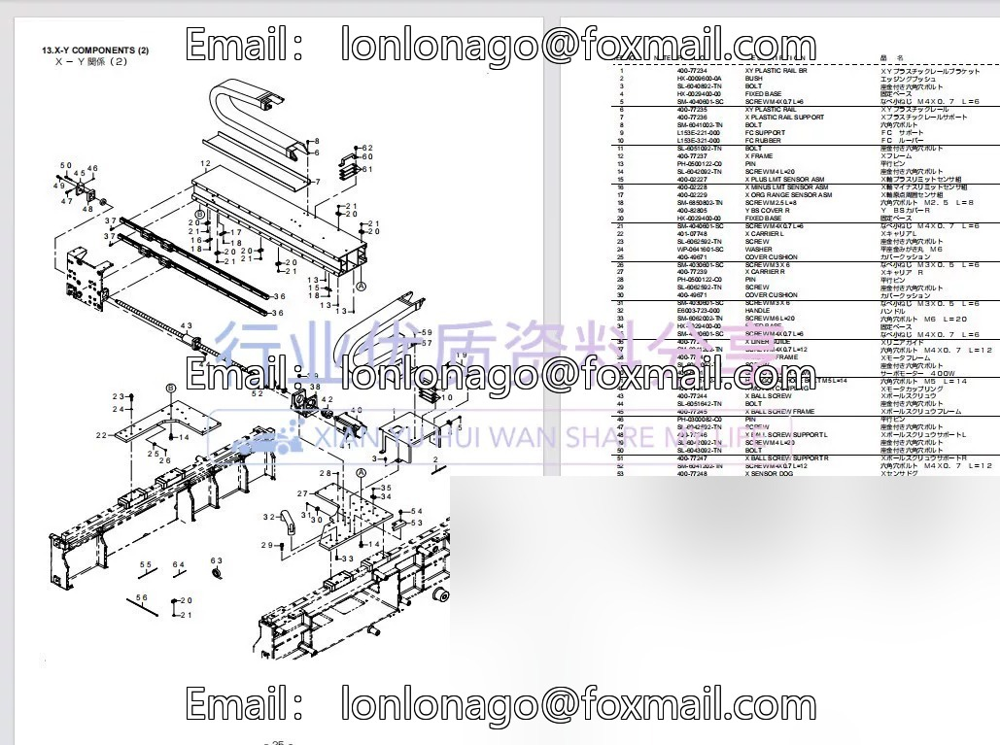
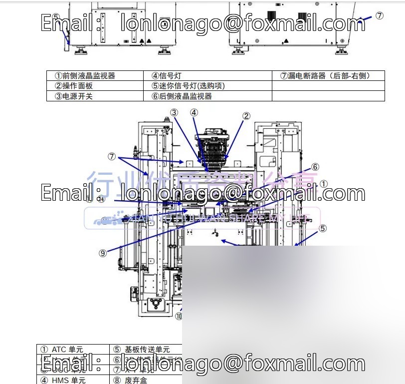
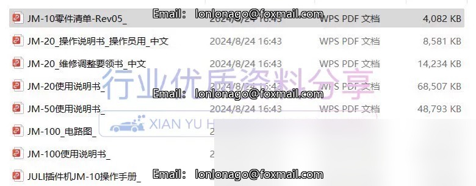

# JUKI plugin machine complete materials: JM-10 20 100 series, description

## Body

JUKI plugin machine complete materials: JM-10 20, 100 series documentation, circuit diagrams, part explosion diagrams, etc.

Take a photo and immediately send the electronic original file! The following images are screenshots of the file directory. Confirm before placing the order! Due to the replicability of electronic filing materials, So after purchase, returns are not allowed! Thanks for understanding!

The full set of JUKI plugin machine materials includes the JM-10, 20 and 100 series, offering instructions, circuit diagrams, part exploded views, plus operation manuals and various component descriptions.

<!-- AI_ENRICHED -->

## Images

## Payment

Here is a pay link on Stripe ( https://buy.stripe.com/3cs8yP7sY87d0vu9AB ). Please contact me lonlonago@foxmail.com after funding $89, and I will send you a complete data files , thank you!

